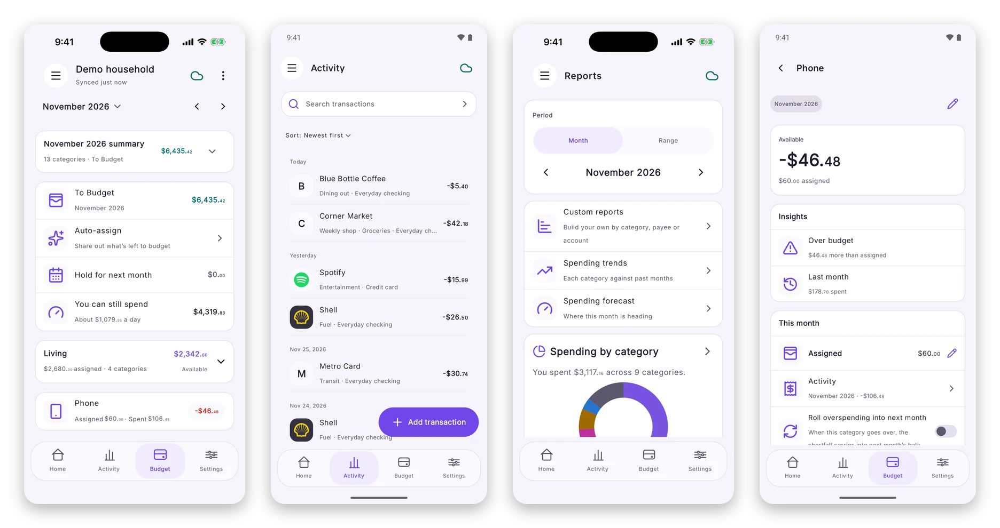
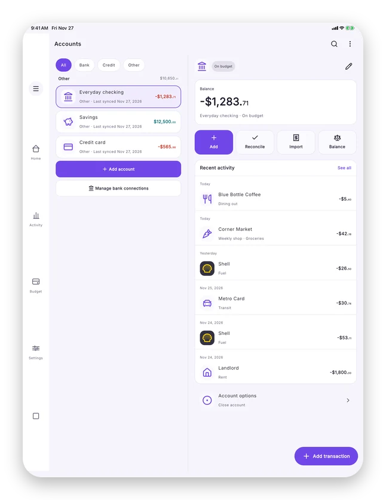
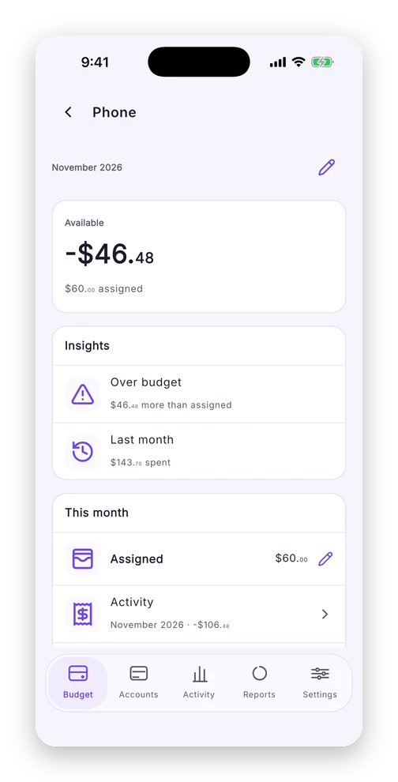

  

<h1 align="center">Tandem for Actual Budget</h1>

  Your budget, everywhere. Access your Actual Budget finances on your phone, even when you are offline.

  <picture>
    <source media="(prefers-color-scheme: dark)" srcset="docs/images/screenshots/hero-dark.webp">
    
  </picture>

Tandem is a mobile app for your own Actual Budget server. It syncs with Actual
directly, keeps a local copy on the phone, and sends saved changes when the
connection returns. Actual remains the source of truth.

## A closer look

  <picture>
    <source media="(prefers-color-scheme: dark)" srcset="docs/images/screenshots/foldable-two-pane-dark.webp">
    
  </picture>

<em>On tablets and unfolded foldables, the list and the details sit side by side.</em>

  <picture>
    <source media="(prefers-color-scheme: dark)" srcset="docs/images/screenshots/ipad-accounts-dark.webp">
    
  </picture>

<em>On iPad, each account shows its balance, quick actions, and recent activity beside the list.</em>

  <picture>
    <source media="(prefers-color-scheme: dark)" srcset="docs/images/screenshots/category-insights-dark.webp">
    
  </picture>

<em>Each category shows how spending is pacing and how it compares with last month.</em>

## Get started

1. Run an Actual Budget server.
2. [Install the app](docs/using/install-app.md), enter your Actual server's
   HTTPS address, and sign in with your Actual password.

Encrypted budgets open with their budget password, as in Actual.

To sync planning details such as savings goals between devices, you can also
run the optional [extension sync service](docs/deploy/install.md).

## How it works

The app downloads each budget from Actual and keeps it on the device. Changes
travel as Actual sync messages, so Actual, its web app and every device stay in
step. Budget calculations run on the device. See
[architecture and trust](docs/concepts/architecture-and-trust.md) and the
[compatibility notes](docs/concepts/actual-compatibility.md).

## Build from source

See [build instructions](docs/develop/build-from-source.md),
[testing instructions](docs/develop/testing.md), the
[toolchain reference](docs/develop/toolchain.md), and the
[extension sync API](docs/develop/api-reference.md). Its machine-readable
contract is [`docs/api/openapi-v1.json`](docs/api/openapi-v1.json).

## Documentation

The [documentation index](docs/README.md) lists every guide by audience.

## License

Tandem is licensed under AGPL-3.0-or-later. See [`LICENSE`](LICENSE).
