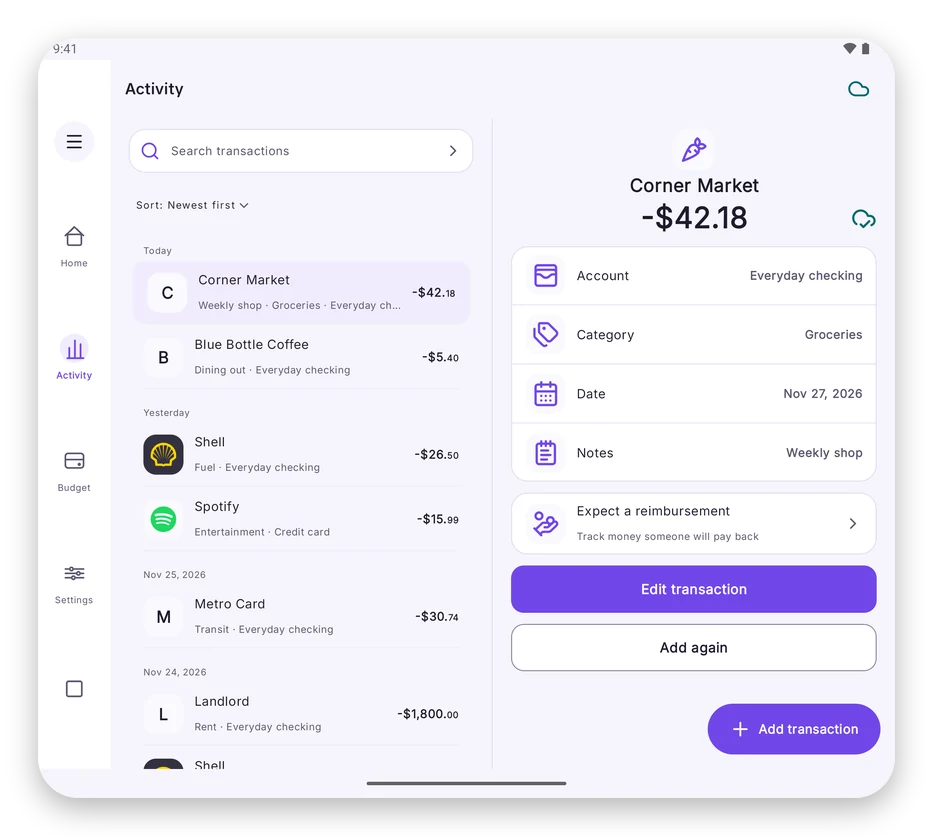

  

<h1 align="center">Tandem for Actual Budget</h1>

  Your budget, everywhere. Access your Actual Budget finances on your phone, even when you are offline.

  <picture>
    <source media="(prefers-color-scheme: dark)" srcset="docs/images/screenshots/hero-dark.webp">
    
  </picture>

Tandem is a mobile app and a small server that connects it to your own Actual
Budget service. Actual remains the source of truth. Tandem keeps a local copy on
the phone and syncs saved changes with Actual when the connection returns.

## A closer look

  <picture>
    <source media="(prefers-color-scheme: dark)" srcset="docs/images/screenshots/foldable-two-pane-dark.webp">
    
  </picture>

<em>On tablets and unfolded foldables, the list and the details sit side by side.</em>

  <picture>
    <source media="(prefers-color-scheme: dark)" srcset="docs/images/screenshots/ipad-accounts-dark.webp">
    
  </picture>

<em>On iPad, each account shows its balance, quick actions, and recent activity beside the list.</em>

  <picture>
    <source media="(prefers-color-scheme: dark)" srcset="docs/images/screenshots/category-insights-dark.webp">
    
  </picture>

<em>Each category shows how spending is pacing and how it compares with last month.</em>

## Get started

1. Run an Actual Budget server.
2. Follow the [server installation guide](docs/deploy/install.md) to set up Tandem's API gateway. Set `ACTUAL_SERVER_URL` in Tandem's `.env` to the Actual server URL reachable from the API container, then start the services with Docker Compose.
3. [Install the Android app](docs/using/install-app.md), enter the HTTPS server address that routes `/api/v1/` to Tandem, and sign in with your Actual account.

The setup script fetches the deployment Compose file from `main` and creates
`.env` on the first run. Docker Compose pulls the Tandem API image using the
tag in `.env`, which defaults to `latest-nightly`. See the
[deployment configuration](docs/deploy/configuration.md) and
[troubleshooting guide](docs/deploy/troubleshooting.md) for server settings and
connection problems. The [operator guides](docs/README.md#run-tandem) also cover
proxy setup, upgrades, backups, and restores.

## How it works

The phone stores its budget copy locally. The Tandem API uses Actual's supported
Node client to read and write budgets. This gives Tandem a server-side trust
boundary; review [architecture and data privacy](docs/concepts/architecture-and-trust.md)
before deploying it. For Actual's encrypted budgets, see the
[compatibility notes](docs/concepts/actual-compatibility.md).

## Build from source

See [build instructions](docs/develop/build-from-source.md),
[testing instructions](docs/develop/testing.md), the
[toolchain reference](docs/develop/toolchain.md), and the
[API reference](docs/develop/api-reference.md). The machine-readable API
contract remains at [`docs/api/openapi-v1.json`](docs/api/openapi-v1.json).

## Documentation

The [documentation index](docs/README.md) lists every guide by audience.

## License

Tandem is licensed under AGPL-3.0-or-later. See [`LICENSE`](LICENSE).
