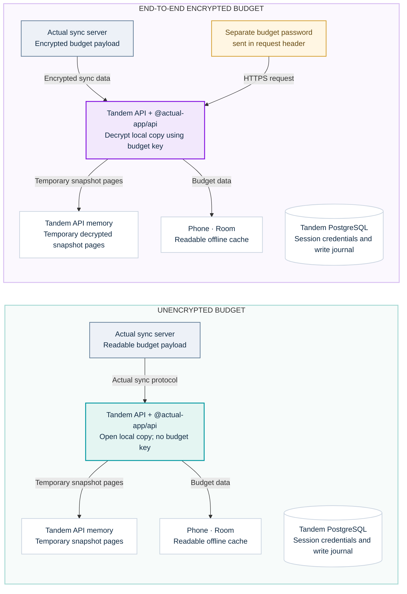

# Architectural design

This page explains why Tandem uses an API service between its Android and iOS
apps and Actual Budget, and what that service means for encrypted budgets.

## Why there is a Tandem API service

Actual does not expose an HTTP REST API for budget operations. Its official
programmatic interface is the Node.js package
[`@actual-app/api`](https://actualbudget.org/docs/api/). The package runs
Actual's budget engine against a local working copy and synchronizes that copy
with an Actual server. Kotlin and Swift are not supported API runtimes.

Tandem's Android and iOS apps share a Kotlin Multiplatform client. Keeping the
official Actual package in one small Node.js service means the two apps can
share the same network and data code without each implementing Actual's
sync protocol. The service is more than a proxy: it signs in through Actual, limits
each device to authorized budgets, serves supported-API snapshots and signals
when a client must replace its remote baseline, and serializes transaction writes so it can detect
and recover from uncertain results and surface conflicts. A bounded in-memory
snapshot cache supports paging; when a snapshot changes or the API restarts,
the phone downloads a replacement snapshot while retaining local pending edits.

| Decision                                                  | Why it fits Tandem                                                              | Cost                                                                    |
| --------------------------------------------------------- | ------------------------------------------------------------------------------- | ----------------------------------------------------------------------- |
| Use Actual's official API in the Tandem service           | Uses the supported Actual integration and gives Android and iOS one shared path | Remote sync and writes require the Tandem service and the Actual server |
| Keep sign-in, budget scopes, and write recovery in Tandem | Access checks and conflict behavior have one implementation                     | Tandem's service and storage become trusted with readable budget data   |
| Cache snapshots in Room on each phone                     | Previously synced budgets stay readable offline                                 | The phone stores a readable local copy                                  |

Actual's synchronization system uses CRDT techniques for multi-device changes.
Projects such as [Actuali](https://github.com/MattFaz/actuali) use a direct
client approach. Tandem chose the official API boundary because it fits the
existing Kotlin Multiplatform apps and avoids maintaining separate
synchronization implementations for Android and iOS. If you want fully
encrypted sync, use Actuali.

## Unencrypted and encrypted budgets

The diagrams compare both paths side by side. Each person signs in to Actual
from Tandem, and the API keeps that account's session token encrypted on the
server. An encrypted budget has a second password: the person enters it in
Tandem, which passes it to Actual's API to unlock that budget.

For an encrypted budget, Tandem sends the budget password in the
`x-budget-encryption-password` request header when an operation needs it. The
password is not saved in Tandem's durable transaction journal. Actual's API
uses it to decrypt the budget into the service's local working copy so Tandem
can read records and apply edits. Snapshot pages are held temporarily in API
memory, and the mobile app stores a readable cache in Room. PostgreSQL retains
the write journal, which can contain transaction values, notes, and base
snapshots until journal removal is completed.

**Actual's end-to-end encryption protects an encrypted budget on the Actual
sync server. It does not hide budget contents from the Tandem API service.**
Anyone deploying Tandem must trust and protect the API host, its local Actual
data directory, its PostgreSQL database and backups, and the phones that cache
budget data. The API's memory cache is lost on restart; clients then resync.
Use HTTPS when a phone connects to a remotely hosted Tandem API.
Actual also documents that local budget data is unencrypted, even when the
remote budget uses end-to-end encryption ([Actual sync and encryption
guide](https://actualbudget.org/docs/getting-started/sync/)).

The same protection boundary applies to exported backups. `deploy/backup.sh`
writes mode-600 plaintext files by default; for an encrypted export, it can
stream both files through GnuPG using a passphrase stored separately from the
backup. See the [backup and restore instructions](../deploy/backup-restore.md).

## Related documentation

- [Actual compatibility and adapter boundary](actual-compatibility.md)
- [Mobile sync behavior](../using/offline-sync-and-conflicts.md)
- [Tandem API reference](../develop/api-reference.md)
- [Official Actual API documentation](https://actualbudget.org/docs/api/)
- [Actual architecture and synchronization overview](https://actualbudget.org/docs/contributing/project-details/)
