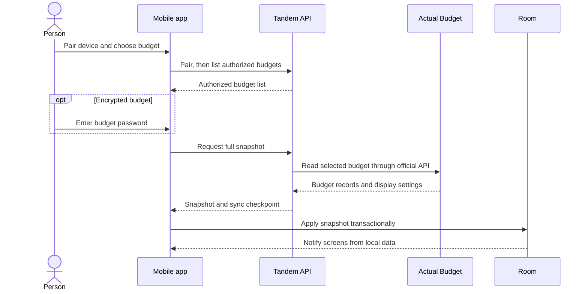
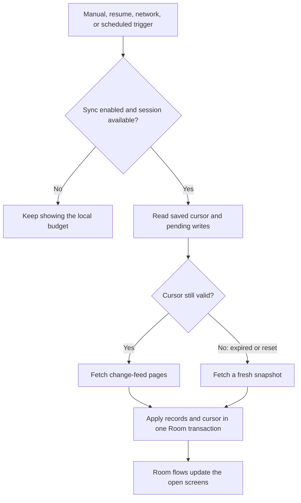
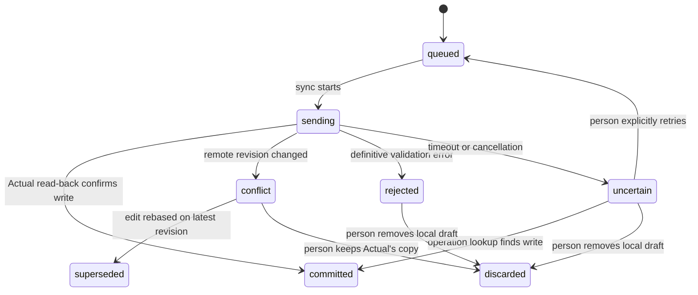

# Mobile sync

Tandem is local-first: once a budget has synced, the app opens its Room cache
without waiting for the server. The sync coordinator updates that cache in the
background, and the screens observe Room directly.

## How the pieces fit

```mermaid
flowchart LR
  UI[Compose UI] --> DB[(Room cache)]
  DB <--> Sync[Sync coordinator]
  Worker[Android WorkManager or iOS background task] --> Sync
  Sync <--> Client[Generated API client]
  Client <--> API[Tandem API]
  API <--> Projection[(Server projection and change feed)]
  API <--> ActualAPI[@actual-app/api]
  ActualAPI <--> Actual[Actual Budget server]
```

The UI reads local records. The coordinator sends changes through the Tandem
API, which reads and writes Actual through its supported API and maintains the
server-side projection used for snapshots and change pages. Tandem does not
write directly to Actual's database.

## First sync



After a successful first sync, Tandem remembers the selected budget locally.
On later launches it opens that cached budget immediately, even if Tandem or
Actual is unreachable. Pairing is needed again only when remote access is
required and the server has explicitly rejected the saved device credential.

## Later refreshes

Manual refresh, app resume, restored network access, and eligible scheduled
work all use the same coordinator.



Each paged run holds the server's `throughCursor` fixed. Tandem applies a page
and its next cursor together; deleted records become tombstones. If the cursor
expires or the server generation changes, the coordinator replaces the remote
baseline from a fresh snapshot while retaining local pending edits. Every
device keeps its own cursor over the shared change feed. See the
[API contract](api/README.md#transaction-reads-and-reconciliation) for feed
retention and reset behavior.

## Saving edits and resolving errors

Saving a transaction writes to Room first. The UI shows that local change
immediately while the durable outbox waits for the server.



An uncertain write is checked by operation ID before the next sync. Tandem
never automatically posts it again; retry is explicit and reuses the same
operation ID and idempotency key. Conflicts keep the local draft for review.
The person can keep Actual's version or rebase the edit on the newest server
revision. If Actual deleted the transaction, the local conflict must be
discarded.

Transaction creates use a stable `tandem:<uuid>` identifier. The API passes it
to Actual as `imported_id` and reads the created row back before committing the
journal entry. Updates, deletes, snapshots, and change-feed reconciliation use
that same identifier. Transaction edits support amount, payee, category, date,
account, and notes. Amounts stay in integer minor units.

## What is available offline

| Screen or data      | Local behavior                                                                                                                         |
| ------------------- | -------------------------------------------------------------------------------------------------------------------------------------- |
| Budget              | Reads the cached month plan, category groups, and categories                                                                           |
| Accounts            | Reads cached accounts and their latest Actual balances                                                                                 |
| Activity and search | Uses the complete cached transaction set; the Activity overview shows its 50 newest rows                                               |
| Reports             | Recomputes totals from Room's indexed transaction columns                                                                              |
| Currency display    | Uses Actual's symbol, precision, and format preferences; device locale supplies separators when Actual has no number-format preference |
| Upcoming bills      | Due-date data is not included in the current mobile sync                                                                               |

When a budget has no saved selection, Tandem opens the most recently synced
local budget. It uses saved catalog metadata for its name and encryption state,
and discovers cached budgets from Room if that metadata is missing.

## Refresh schedule

| Trigger                    | Android                                                                                | iOS                                                                         |
| -------------------------- | -------------------------------------------------------------------------------------- | --------------------------------------------------------------------------- |
| Foreground                 | Manual refresh; resume and network-restoration refresh when enabled                    | Manual refresh; app-active and network-restoration refresh when enabled     |
| Periodic                   | Unique WorkManager request with a six-hour interval and a connected-network constraint | `BGAppRefreshTask` with a six-hour earliest start; iOS decides when it runs |
| Metered network preference | Can require an unmetered network                                                       | Waits for a path that is not marked expensive or constrained                |
| Encrypted budgets          | Background work skips these budgets because passwords are not stored                   | Background work skips these budgets for the same reason                     |

Android and iOS may defer scheduled work to satisfy their power and network
rules. iOS scheduling has a native host target, but its background runtime
behavior still needs a macOS simulator or device check. Foreground sync can use
the password entered to unlock an encrypted budget.

Resume and network events coalesce while a sync is active. Successful attempts
have a 30-second per-budget cooldown; a failed attempt can queue one follow-up.
Android workers and the open app may use separate database instances, so Room
multi-instance invalidation keeps the visible screens current.

## Credentials and encryption

| Item              | Handling                                                                                        |
| ----------------- | ----------------------------------------------------------------------------------------------- |
| Pairing code      | Used once for pairing; never persisted                                                          |
| Device credential | Android stores an AES-GCM record with its key in Keystore; iOS uses a device-only Keychain item |
| Budget password   | Sent only on requests that need it; never stored in Room or the outbox                          |
| Cached budget     | Stored locally so the selected budget remains readable offline                                  |

Actual-encrypted budgets are decrypted by Actual's API for Tandem's server-side
projection and the mobile cache. Actual's encryption therefore does not protect
those working copies. See [the architecture notes](architectural-design.md)
for the server trust boundary and the fully encrypted alternative.

“Forget this device” revokes the server token before removing the local
credential. If Tandem is unreachable, the credential stays available so the
revocation can be retried. Device tokens expire after 90 days of inactivity.

## Code map

| Module                                  | Responsibility                                                                             |
| --------------------------------------- | ------------------------------------------------------------------------------------------ |
| `mobile/data`                           | Room records, local overlays, change cursor, durable outbox, and sync coordinator          |
| `mobile/api-client`                     | Generated OpenAPI client and adapter for the data module                                   |
| `mobile/composeApp`                     | Shared Compose screens observing Room flows                                                |
| `mobile/androidApp` and `mobile/iosApp` | Platform hosts, secure credential stores, and scheduled work                               |
| `services/api`                          | Device authorization, budget projection, change feed, write journal, and Actual API access |

## Local checks

Run from `mobile/`:

```sh
./gradlew :data:jvmTest :data:koverVerify :data:ktlintCheck \
  :api-client:jvmTest :api-client:koverVerify :api-client:ktlintCheck
./gradlew :composeApp:compileAndroidMain :composeApp:compileKotlinIosArm64 \
  :composeApp:compileKotlinIosSimulatorArm64 :composeApp:ktlintCheck \
  :androidApp:assembleDebug
```

The iOS simulator app and scheduled-refresh runtime checks require macOS.
