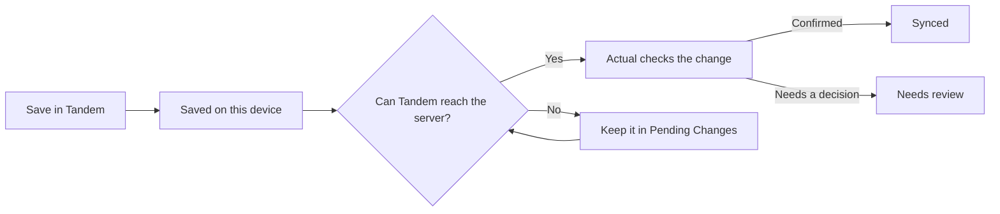

# Use Tandem offline and review conflicts

For people using Tandem on a phone. The local budget works offline after it has
synced successfully on this device once.

## What happens when you save

Tandem saves supported changes on this phone first. When the Tandem server and
Actual are reachable, Tandem sends the change and waits for Actual to confirm
it. Until then, the change is listed in **Pending Changes** and is not yet
saved in Actual.

Tandem tries again when you sync, return to the app, or the connection returns.
The phone may defer background work, so use **Sync** when you need it to try
now. See [sync status names](sync-status.md) for the labels shown in the app.

## What works without a connection

| Area                                            | Works offline                                                                                             | Needs a connection                                                                                                                      |
| ----------------------------------------------- | --------------------------------------------------------------------------------------------------------- | --------------------------------------------------------------------------------------------------------------------------------------- |
| Budget, accounts, activity, search, and reports | Read the budget and transactions saved on this phone.                                                     | First sign-in, opening a budget never synced here, or refreshing from Actual.                                                           |
| Transactions                                    | Add, edit, and delete locally. New transactions can use a payee or account that is still waiting to sync. | Actual must confirm the change before Tandem marks it synced.                                                                           |
| Payees, categories, and budget plan             | Queue supported payee, category, group, and assigned-amount changes.                                      | Actual must confirm queued changes before other devices see them.                                                                       |
| Accounts                                        | Queue supported account creation, rename, close, reopen, and order changes.                               | Actual must confirm the change.                                                                                                         |
| Existing schedules                              | View saved schedules; queue supported edits, deletes, posts, and skips.                                   | Tandem cannot create a new schedule. Actual must confirm queued actions.                                                                |
| Statement import                                | Submit a previewed import if the connection drops after preview; it waits in Pending Changes.             | Connect to Tandem and Actual to preview a file and check for duplicate rows.                                                            |
| Bank sync and budget discovery                  | Keep using a previously synced budget.                                                                    | Sign-in, finding budgets, and bank sync through Actual.                                                                                 |
| Encrypted budgets                               | Read a cached budget.                                                                                     | Enter the budget password to sync it in the foreground. Tandem does not save this password or sync encrypted budgets in the background. |

The local copy belongs to the server and Actual account used to sign in. A
different account cannot use it. For details about what the server and phone
can read, see [data and privacy](../concepts/architecture-and-trust.md).

## Review a conflict

Actual may have changed or deleted a transaction while this phone had another
edit waiting. Tandem keeps the local edit and marks it **Needs review** so you
can compare it with Actual.

1. Open **Pending Changes** and select the item marked **Needs review**.
2. Compare the versions and choose one of the actions shown on the screen.
3. Keep Tandem open until it confirms the choice.

**Check:** the item leaves the review list only after the server confirms the
resolution. If the phone goes offline, the choice cannot be completed; reconnect
and try again. If the status is unknown, check the operation status before
retrying or removing the edit. See [sync status names](sync-status.md).

## Keep local changes safe

Do not clear app data, uninstall Tandem, or sign out while **Pending Changes**
contains work that is pending, needs review, or has an unknown status. The phone
must receive a successful server response before a conflict is resolved. A
queued change is not a copy in Actual until that confirmation arrives.

For server-side trust and encrypted budgets, see [Architecture and trust](../concepts/architecture-and-trust.md).
For what Tandem sends to Actual, see [Actual compatibility](../concepts/actual-compatibility.md).
